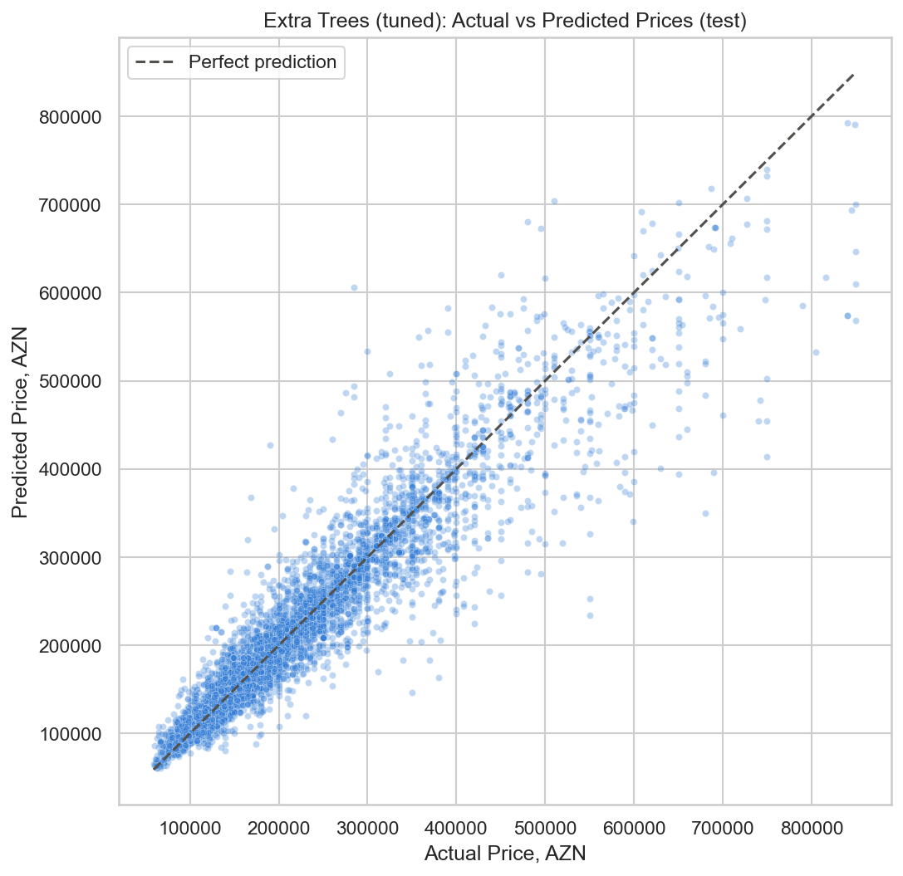

# Azerbaijani Apartment Price Prediction

This project predicts apartment prices in Baku, Azerbaijan using machine learning.

The dataset is based on real house and apartment listings scraped from Bina.az on November 9, 2023. I used this project to practice a full regression workflow: loading real data, cleaning messy scraped columns, preparing features, training several models, and evaluating their performance.

Dataset source: https://www.kaggle.com/datasets/elvinrustam/house-listings-in-baku

If GitHub does not render the notebook, open it with nbviewer:
https://nbviewer.org/github/akshin777mansurov/house-price-prediction/blob/main/House_Price_Prediction.ipynb

## Project Overview

The main goal of this project is to predict apartment prices using listing features such as apartment area, number of rooms, building type, floor information, repair status, mortgage availability, title deed status, address, and location information.

The target column is `price`.

The final model reached an R2 score of about **0.89**, which means it explains almost **90% of the price variation** in the test data. The best model also achieved a MAPE of about **9%**, meaning the average prediction error is around 9% of the real apartment price.

## Dataset

The dataset contains house and apartment listings from Baku, Azerbaijan. It includes information about the apartment itself, the building, legal/repair status, and location.

The raw data was not ready for modeling. Some values were stored as text, some columns needed to be converted into numeric format, and some features had to be created from existing columns.

I did not use every raw column directly. For example, listing URLs are only identifiers, currency is not useful because prices are already in AZN, and `price_1m2` was removed from model features because it is calculated from price and area. Using `price_1m2` would create data leakage and make the model unrealistically strong.

## Limitations

The model performs well, but apartment prices depend on many factors that are not fully available in the dataset.

Important missing factors include:

- whether the building has a yard
- parking availability
- elevator availability
- distance to metro stations
- distance to shopping centers
- exact building condition
- view from the apartment
- quality of renovation
- nearby schools, parks, and transport
- seller urgency and market timing

Because these factors are missing, the model cannot perfectly predict every apartment price. Still, the result is  **90%** , for a real estate prediction project using public listing data it is good result.

## Data Cleaning

The dataset was not clean, because it came from real scraped listings. Several columns were stored as text and had to be converted before modeling.

Main cleaning steps:

- removed duplicate listings using listing URLs
- converted price, area, and room count into numeric values
- converted repair, mortgage, and title deed information into binary values
- split floor information into apartment floor and total building floors
- created a feature for whether the apartment is on the last floor
- cleaned address and title text
- extracted useful location information from listing titles
- grouped rare addresses and locations as `Other`
- removed unrealistic values and strong outliers
- removed `price_1m2` from model features to avoid data leakage

## Models Used

I compared five regression models:

- Linear Regression
- Random Forest Regressor
- Extra Trees Regressor
- Gradient Boosting Regressor
- HistGradientBoosting Regressor

Linear Regression was used as a baseline. It is simple and helps show whether more advanced models actually improve prediction quality.

The other models are tree-based models. I chose them because apartment prices usually depend on non-linear relationships. For example, the effect of location, apartment area, building type, floor, repair status, and mortgage availability is not always a simple straight-line relationship.

Random Forest and Extra Trees train many decision trees and combine their predictions, which usually works well with tabular real estate data. Gradient Boosting and HistGradientBoosting were added because boosting models learn from previous errors step by step and can capture more detailed patterns.

## Log Transformation

Apartment prices are right-skewed: most apartments are in a normal price range, while a smaller number of listings are much more expensive.

Because of this, I used log transformation for the target variable during model training. The models were trained on `log(price)` and predictions were converted back to AZN.

This helps reduce the influence of very expensive apartments and often improves performance in house price prediction tasks.

## Results

| Model | RMSE | MAE | R2 Score | MAPE (%) |
|---|---:|---:|---:|---:|
| Extra Trees | 38551.03 | 20570.75 | 0.8926 | 9.01 |
| Random Forest | 38576.12 | 21358.88 | 0.8925 | 9.34 |
| HistGradientBoosting | 44227.54 | 27695.48 | 0.8587 | 11.86 |
| Gradient Boosting | 50177.83 | 32263.29 | 0.8181 | 14.11 |
| Linear Regression | 50973.36 | 31389.42 | 0.8122 | 13.32 |

The best model was **Extra Trees Regressor**.

It reached:

```text
R2 Score: 0.8926
MAPE: 9.01%
```

In simple words, the model explains almost 90% of apartment price variation in the test data.

## Predicted vs Actual Prices

The chart below compares the best model's predicted prices with the real apartment prices. The red dashed line represents perfect predictions, so points closer to the line mean better predictions.




## Tech Stack

- Python
- pandas
- NumPy
- scikit-learn
- matplotlib
- seaborn
- Jupyter Notebook

## How to Run

Install the required libraries:

```bash
pip install -r requirements.txt
```

Open Jupyter Notebook:

```bash
jupyter notebook
```

Then run:

```text
House_Price_Prediction.ipynb
```

## Conclusion

This project shows a complete machine learning workflow for apartment price prediction in Baku. The most important part was not only training models, but also cleaning the raw scraped data properly.

After improving the dataset cleaning, feature preparation, and model selection, the final model reached almost 90% R2 score, which is a strong result for a real-world real estate dataset.
