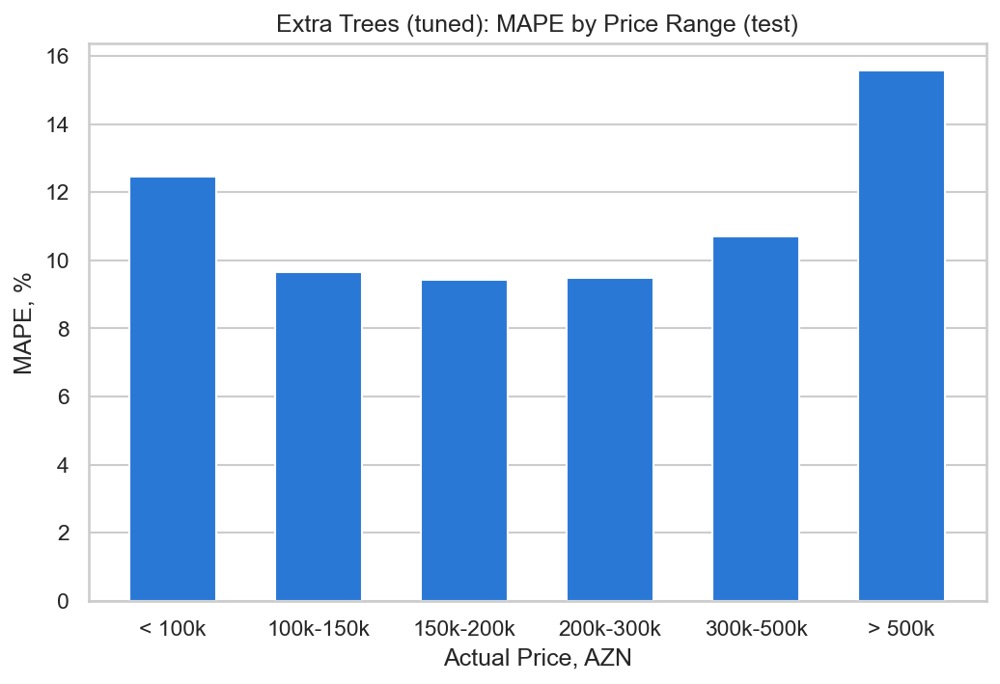
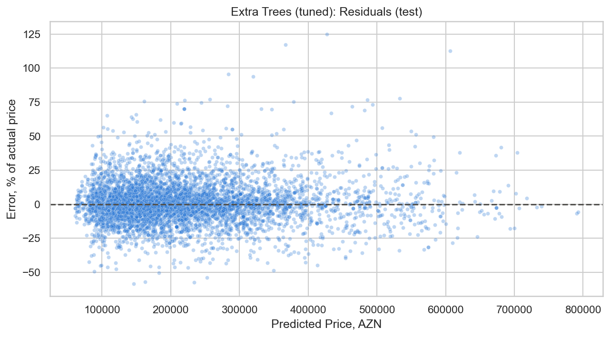

# Azerbaijani Apartment Price Prediction

This project predicts apartment prices in Baku, Azerbaijan using machine learning.

The dataset is based on real apartment listings scraped from Bina.az on November 9, 2023. I used this project to practice a full regression workflow: loading real data, cleaning messy scraped columns, removing duplicate listings, comparing models, and validating the result in a correct way.

Dataset source: https://www.kaggle.com/datasets/elvinrustam/house-listings-in-baku

If GitHub does not render the notebook, open it with nbviewer:
https://nbviewer.org/github/akshin777mansurov/house-price-prediction/blob/main/House_Price_Prediction.ipynb

## Project Overview

The main goal of this project is to predict apartment prices using listing features such as apartment area, number of rooms, building type, floor information, repair status, mortgage availability, title deed status, and location.

The target column is `price`.

Results on unseen test data:

| | MAPE | Median error | MAE | R2 Score |
|---|---:|---:|---:|---:|
| Final model (tuned Extra Trees) | 10.1% | 6.8% | 23,343 AZN | 0.883 |
| Baseline (area × median price per m² of the location) | 15.6% | 12.6% | 35,176 AZN | 0.804 |

These numbers are for apartments inside the model limits: price from 59,000 to 850,000 AZN and area up to 280 m².

In simple words: the average prediction error is about 10% of the real price. This is about one third lower than the error of a simple baseline.

## Dataset

The dataset contains house and apartment listings from Baku, Azerbaijan. It includes information about the apartment itself, the building, legal/repair status, and location.

The raw data was not ready for modeling. Some values were stored as text, some columns needed to be converted into numeric format, and some features had to be created from existing columns.

I did not use every raw column directly. For example, listing URLs are only identifiers, currency is not useful because prices are already in AZN, and `price_1m2` was removed from model features because it is calculated from price and area. Using `price_1m2` would create data leakage and make the model unrealistically strong.

## Data Cleaning

The dataset was not clean, because it came from real scraped listings. Several columns were stored as text and had to be converted before modeling.

Main cleaning steps:

- converted price, area, and room count into numeric values, and checked the result against the `price_1m2` column from the website
- converted title deed and mortgage information into binary values
- kept missing repair information as a separate value `unknown` instead of setting it to "no repair"
- split floor information into apartment floor and total building floors
- created a feature for whether the apartment is on the last floor
- extracted the location from listing titles
- removed unrealistic values with fixed rules
- removed duplicate listings
- removed `price_1m2` from model features to avoid data leakage

### Duplicate Listings

Every listing has a unique URL, so a duplicate check by URL finds nothing. But the same apartment is often posted again with a new URL, for example by another agent or after a price change.

I checked duplicates by the content of the listing. I found 1,909 repeated listings (5.4% of the data): 748 exact copies, and the rest are the same apartment with an updated price. For each apartment I kept only the newest listing.

## Validation

This is the most important part of the project. I wanted the final score to be honest, so I built the validation step by step:

1. **Group train/test split.** Listings with the same title and floor are very similar and are often the same apartment. I keep them together, so they are never in both train and test. With a simple random split the model could just remember the price.
2. **Outlier limits from the training data only.** The limits for price, area, and price per square meter are calculated after the split, only from the training data. They also define the scope of the model.
3. **Baseline.** Before training models, I calculate a simple baseline: area × median price per m² of the location. A model is useful only if it is clearly better than this.
4. **Cross-validation.** I compare models with 5-fold group cross-validation on the training data. My main metric is MAPE.
5. **Overfitting check.** I compare the error on the training folds with the error on the validation folds.
6. **Tuning.** I tune the two most promising models with a small grid search, using the same cross-validation.
7. **One final test.** The final model is chosen by cross-validation. The test set is used only one time, at the end.

## Models Used

I compared a baseline and five regression models:

- Baseline (area × median price per m² of the location)
- Linear Regression
- Random Forest Regressor
- Extra Trees Regressor
- Gradient Boosting Regressor
- HistGradientBoosting Regressor

Linear Regression is the simplest real model. The other models are tree-based models. I chose them because apartment prices usually depend on non-linear relationships. For example, the effect of location, apartment area, building type, floor, and repair status is not always a simple straight-line relationship.

Random Forest and Extra Trees train many decision trees and combine their predictions, which usually works well with tabular real estate data. Gradient Boosting and HistGradientBoosting were added because boosting models learn from previous errors step by step and can capture more detailed patterns.

I also tested the street address as a feature. In cross-validation it did not improve the error (10.86% with and without it), so I do not use it.

## Log Transformation

Apartment prices are right-skewed: most apartments are in a normal price range, while a smaller number of listings are much more expensive.

Because of this, I used log transformation for the target variable during model training. The models were trained on `log(price)` and predictions were converted back to AZN.

This helps reduce the influence of very expensive apartments and often improves performance in house price prediction tasks.

## Results

### Cross-Validation

5-fold group cross-validation on the training data (25,891 apartments):

| Model | CV MAPE (%) | CV MAE | CV R2 | Train MAPE (%) |
|---|---:|---:|---:|---:|
| Extra Trees (tuned) | 10.64 | 24,643 | 0.876 | 0.57 |
| Extra Trees | 10.86 | 25,009 | 0.870 | 0.57 |
| Random Forest | 11.07 | 25,525 | 0.872 | 3.87 |
| HistGradientBoosting (tuned) | 11.13 | 26,103 | 0.872 | 7.49 |
| HistGradientBoosting | 12.29 | 28,946 | 0.854 | 11.51 |
| Linear Regression | 14.09 | 33,340 | 0.800 | 14.03 |
| Gradient Boosting | 14.35 | 33,086 | 0.816 | 14.12 |
| Baseline | 15.93 | 36,210 | 0.799 | 15.80 |

The best model is the tuned **Extra Trees Regressor**.

Two things are important in this table:

- The baseline already has an R2 of 0.80. So a high R2 alone does not mean much for this data. This is why I use MAPE as the main metric.
- Extra Trees has a train error of 0.6% and a validation error of 10.6%. It almost fully remembers the training data, so its train score is useless. I tested smaller trees in the tuning step, and they made the validation error worse, so I kept the full trees.

### Final Test

The test set has 6,650 apartments. 6,386 of them are inside the model limits.

| | MAPE (%) | Median error (%) | MAE | R2 Score |
|---|---:|---:|---:|---:|
| Final model, inside limits | 10.12 | 6.80 | 23,343 | 0.883 |
| Baseline, inside limits | 15.63 | 12.63 | 35,176 | 0.804 |
| Final model, full test set | 11.67 | 7.18 | 31,767 | 0.724 |
| Baseline, full test set | 16.97 | 13.02 | 42,169 | 0.742 |

The test result is close to the cross-validation result (10.1% and 10.6%), so cross-validation gave an honest estimate.

About 64% of the predictions are within 10% of the real price, and 86% are within 20%.

On the full test set R2 falls to 0.72, and it is even lower than the R2 of the baseline. The reason is the luxury apartments outside the model limits. The model never saw a price above 850,000 AZN in training, and a tree model cannot predict a price higher than the prices it saw. So the model should be used only inside its limits.

### Errors by Price Range

| Actual price, AZN | Apartments | MAPE (%) | MAE | Mean error |
|---|---:|---:|---:|---:|
| < 100k | 471 | 12.5 | 10,451 | +8,106 |
| 100k-150k | 1,620 | 9.6 | 12,460 | +4,590 |
| 150k-200k | 1,415 | 9.4 | 16,696 | +2,415 |
| 200k-300k | 1,681 | 9.5 | 23,525 | +610 |
| 300k-500k | 990 | 10.7 | 40,727 | -11,459 |
| > 500k | 209 | 15.6 | 97,951 | -88,607 |



The model is best for apartments between 100,000 and 300,000 AZN. It predicts too high prices for the cheapest apartments and too low prices for the most expensive ones.

### Predicted vs Actual Prices

The chart below compares the predicted prices of the final model with the real apartment prices in the test set. The dashed line represents perfect predictions, so points closer to the line mean better predictions.


The next chart shows the error of each prediction in percent of the real price.



## What Changed From the First Version

The first version of this project reported an R2 of 0.89 and a MAPE of 9.0%. When I reviewed the validation, I found that this result was too optimistic:

- duplicates were checked only by URL, so the same apartment could be in both train and test
- outlier limits and rare categories were calculated on all data before the split
- there was only one random split, no baseline, and no cross-validation
- the best model was chosen by its test score
- overfitting was not checked

After fixing these problems, the final model has an R2 of 0.88 and a MAPE of 10.1%. The new numbers are a little worse, but they are measured in a correct way.

## Limitations

- The model is valid only inside its limits: price from 59,000 to 850,000 AZN and area up to 280 m². For luxury apartments the errors are very large.
- The model is weaker at both ends of the price range, as the table above shows.
- The prices are asking prices from listings, not real sale prices.
- The data is from one day, so I could not check how the model works on later data.
- Some duplicates can still be in the data, for example the same apartment with a different address text. I do not delete them because I cannot be sure, but the group split keeps them on one side.

Apartment prices also depend on many factors that are not available in the dataset:

- whether the building has a yard
- parking availability
- elevator availability
- distance to metro stations
- distance to shopping centers
- exact building condition
- view from the apartment
- quality of renovation
- nearby schools, parks, and transport
- seller urgency and market timing

Because these factors are missing, the model cannot perfectly predict every apartment price.

## Example Prediction

The notebook also includes a small prediction function. It checks the inputs and predicts the price for one apartment.

For the location, the function uses simple text matching. The user can type a location in a natural way, even without Azerbaijani characters or with a small spelling difference. The text is normalized first, then matched with help of `difflib` to the closest known location from the training data.

```python
predict_price(
    category="Yeni tikili",
    area=100,
    room_number=3,
    apartment_floor=9,
    building_floors=16,
    repair="yes",
    mortgage="no",
    title_deed="yes",
    location="qaraqarayev"
)
```

```text
Matched location: Qara Qarayev m.
Predicted price: 215200 AZN
```

If the input is too different and no close location is found, the function returns an error instead of making an unreliable prediction.

## Tech Stack

- Python
- pandas
- NumPy
- scikit-learn
- matplotlib
- seaborn
- Jupyter Notebook

## How to Run

I tested the project with Python 3.12 and the library versions from `requirements.txt`.

Install the required libraries:

```bash
pip install -r requirements.txt
```

Open Jupyter Notebook:

```bash
jupyter notebook
```

Then open `House_Price_Prediction.ipynb` and run all cells. It takes about 8 minutes, because of cross-validation and tuning.

## Conclusion

This project shows a complete machine learning workflow for apartment price prediction in Baku. The most important part was not only training models, but also cleaning the raw scraped data and validating the result properly.

The final model predicts apartment prices with an average error of about 10% on unseen data, which is about one third better than a simple baseline. I also know where the model is weak: the cheapest apartments, the most expensive apartments, and everything outside its limits.
